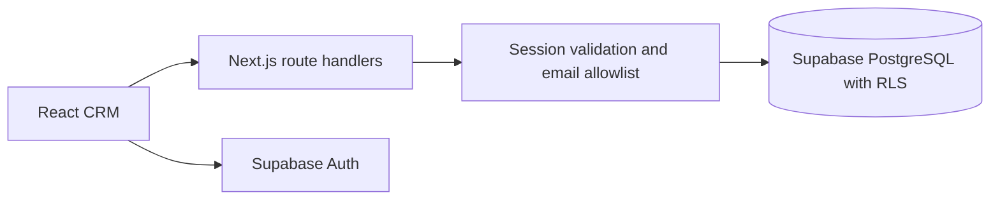

# Architecture

PolicyPilot is a Next.js application with a browser CRM, server API routes, and a Supabase PostgreSQL database.

## Application layers

- `src/app/` contains pages and API route handlers.
- `src/components/` contains the dashboard, customer, policy, renewal, follow-up, import, reports, and settings interfaces.
- `src/context/` coordinates session and portfolio state.
- `src/lib/services/` contains database operations and business rules.
- `src/lib/import/` normalizes spreadsheet values, validates rows, and checks duplicates.
- `src/lib/supabase/` provides separate browser, server, administrative, and pagination helpers.

## Data model

The database includes `profiles`, `customers`, `policies`, `follow_ups`, `activities`, `imports`, `import_errors`, and `automation_logs`. Versioned SQL migrations define schema, ownership checks, related-record constraints, and access policies.

Customers can have multiple policies and follow-ups. Import jobs retain validation results. Activity records describe portfolio changes. Records are scoped to an owning account; there is no shared organization workspace.

## Access control

Supabase Auth establishes identity. Server routes validate sessions and enforce the configured application email allowlist. Database Row Level Security and ownership constraints enforce portfolio boundaries independently of the UI.

A publishable key is used by the browser. Service-role credentials are reserved for explicit server administration and must never enter browser bundles or source control. Account isolation should be retested whenever schema or authorization rules change.

## Dates and pagination

Renewal and overdue calculations use Indian calendar dates. Calendar-year renewal handling accounts for leap days. Paginated fetch helpers collect complete datasets instead of treating the database's default response limit as a complete portfolio.

## Spreadsheet imports

The import flow reads CSV/XLSX files, maps columns, normalizes values, validates required data, and detects duplicates before writing accepted records. Validation errors are retained for review. An import is not an atomic database restore.

## Automation

The daily-summary endpoint uses a server-side authorization secret. Summary generation and delivery are separate concerns. The deployed messaging behavior is simulated; log entries do not prove actual email delivery.

## Verification

`npm test` runs portable business-rule and security regression suites. Lint, TypeScript checks, and a production build provide additional checks. Real browser and database tests require a configured, authorized testing environment and disposable records.
